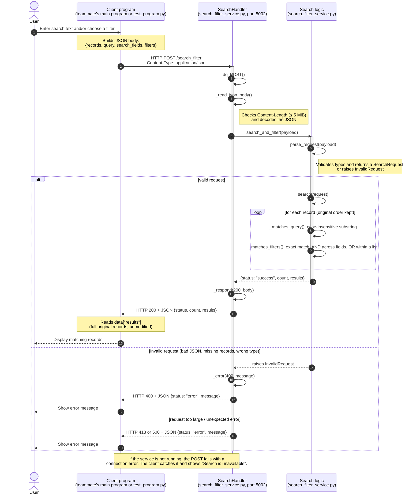

# CS361 - Search and Filter Microservice

A small, reusable HTTP service that **searches and filters any list of JSON records**. You send it your records and your search/filter criteria; it sends back the records that match, unchanged and in their original order.

It is built for all four team projects (to-do list, grocery inventory, stock trader, animal rescue). It does not import any app's code, does not own a database, and never modifies or stores the records you send.

- **Communication pipe:** REST API (HTTP + JSON)
- **Default address:** `http://127.0.0.1:5002`
- **Requirements:** Python 3.10+, no third-party packages

---

## Quick start

```bash
git clone https://github.com/acheng-code/cs361-microservice-search-filter.git

cd cs361-microservice-search-filter

python search_filter_service.py
```

You should see `Search & Filter service running at http://127.0.0.1:5002`. Keep this terminal open while your app runs; stop it with Ctrl+C.

Check that it works from a second terminal:

```bash
curl http://127.0.0.1:5002/health
# {"status": "ok", "service": "search_filter"}

curl -X POST http://127.0.0.1:5002/search_filter \
  -H "Content-Type: application/json" \
  -d '{"records": [{"name": "Milk"}, {"name": "Cheese"}], "query": "milk"}'
# {"status": "success", "count": 1, "results": [{"name": "Milk"}]}
```

> **Windows PowerShell:** use `curl.exe` instead of `curl`, or test with `python client_examples.py`.

### Configuration (optional)

Set these environment variables before starting the service:

| Variable | Default | Purpose |
|---|---|---|
| `SEARCH_FILTER_PORT` | `5002` | Port to listen on |
| `SEARCH_FILTER_HOST` | `127.0.0.1` | Address to bind (localhost only by default) |
| `SEARCH_FILTER_ALLOW_ORIGIN` | `*` | CORS `Access-Control-Allow-Origin` value for browser clients; set to an empty string to disable CORS |

```bash
SEARCH_FILTER_PORT=6000 python search_filter_service.py          # macOS / Linux
$env:SEARCH_FILTER_PORT=6000; python search_filter_service.py    # Windows PowerShell
```

---

## Requesting data

Send a `POST` request to `/search_filter` with a JSON body and the header `Content-Type: application/json`.

| Field | Type | Required | Default | Meaning |
|---|---|---|---|---|
| `records` | array of objects | **yes** | | The records to search, for example your tasks, groceries, stocks or pets |
| `query` | string | no | `""` | Text to find (substring match). Empty means "no text search" |
| `search_fields` | array of strings | no | all fields | Which fields `query` looks in |
| `filters` | object | no | `{}` | Exact-match conditions: `{"field": value}` or `{"field": [value1, value2]}` |
| `case_sensitive` | boolean | no | `false` | Applies to both `query` and `filters` |

**Example request:**

```json
{
  "records": [
    {"name": "Milk", "category": "Dairy", "quantity": 2},
    {"name": "Almond Milk", "category": "Plant-Based", "quantity": 1},
    {"name": "Cheese", "category": "Dairy", "quantity": 1}
  ],
  "query": "milk",
  "search_fields": ["name"],
  "filters": {"category": "Dairy"}
}
```

### Python example

`client_examples.py` contains a ready-to-copy function, `call_search_service`, that uses only the standard library and raises `SearchServiceError` if the service is down or rejects the request:

```python
from client_examples import call_search_service, SearchServiceError

try:
    matches = call_search_service(
        records=my_tasks,                       # list of dicts from your app
        query="report",
        search_fields=["title", "description"],
        filters={"status": ["open", "pending"]},
    )
except SearchServiceError as error:
    show_error_to_user(f"Search is unavailable: {error}")
```

Using `requests` instead:

```python
import requests

response = requests.post(
    "http://127.0.0.1:5002/search_filter",
    json={"records": my_tasks, "query": "report", "search_fields": ["title"]},
    timeout=3,
)
response.raise_for_status()
matches = response.json()["results"]
```

### JavaScript example (browser or Node 18+)

The service sends CORS headers, so a web page on another port can call it directly:

```javascript
const response = await fetch("http://127.0.0.1:5002/search_filter", {
  method: "POST",
  headers: { "Content-Type": "application/json" },
  body: JSON.stringify({
    records: pets,
    query: "max",
    search_fields: ["name", "breed"],
    filters: { species: "Dog" },
  }),
});
const data = await response.json();
if (!response.ok) throw new Error(data.message);
const matches = data.results;
```

---

## Receiving data

The service responds with JSON.

**Success (HTTP 200):**

```json
{
  "status": "success",
  "count": 1,
  "results": [
    {"name": "Milk", "category": "Dairy", "quantity": 2}
  ]
}
```

- `results` contains the **full original records** that matched, in the **same order** you sent them.
- `count` is the number of results. A search with no matches is still a success: `count` is `0` and `results` is `[]`.

**Errors** always return `{"status": "error", "message": "..."}` with one of these status codes:

| HTTP status | When it happens | What your app should do |
|---|---|---|
| 400 | Body is not valid JSON, `records` is missing, or an option has the wrong type (the `message` says which) | Fix the request; this is a bug in the calling code |
| 404 | Wrong path or method (for example `GET /search_filter`) | Check the URL |
| 411 | `Content-Length` header missing | Most HTTP libraries add it automatically |
| 413 | Body larger than 5 MiB | Send fewer records |
| 500 | Unexpected error inside the service | Show an error message; report it to Amina with the request you sent |

If the service is **not running**, your HTTP library raises a connection error instead of returning a status code (`URLError` / `ConnectionError` in Python, a rejected `fetch` promise in JavaScript). Catch it and tell the user search is unavailable. Don't silently fall back to showing everything.

### Example: receiving and using the response (Python)

This continues from the request in [Requesting data](#requesting-data). It reads the HTTP status and the JSON body, then uses `status`, `count` and `results`. It is the same code that `test_program.py` runs.

```python
import json
from urllib.error import HTTPError, URLError
from urllib.request import Request, urlopen

# payload = the request dict from "Requesting data" (records, query, search_fields, filters)
request = Request("http://127.0.0.1:5002/search_filter",
                  data=json.dumps(payload).encode("utf-8"), method="POST",
                  headers={"Content-Type": "application/json"})
try:
    with urlopen(request, timeout=3) as response:        # HTTP 200
        data = json.loads(response.read().decode("utf-8"))
except HTTPError as error:                               # HTTP 400, 404, 413, 500
    data = json.loads(error.read().decode("utf-8"))
except URLError:                                         # service not running
    data = {"status": "error", "message": "Search service is unavailable"}

if data["status"] == "success":
    print(f"{data['count']} match(es)")
    for record in data["results"]:                       # full original records
        print(record["name"])
else:
    print("Error:", data["message"])                     # e.g. "records is required"
```

Output for the example request above:

```text
1 match(es)
Milk
```

### Example: receiving the response (JavaScript)

```javascript
const data = await response.json();          // response from the fetch() call above
if (data.status === "success") {
  data.results.forEach((pet) => console.log(pet.name));
} else {
  console.error(data.message);
}
```

### Health check

`GET /health` returns `{"status": "ok", "service": "search_filter"}`. Use it to check whether the service is up.

---

## Matching rules

- **Query:** case-insensitive substring match. `"mil"` matches `"Almond Milk"`. Leading and trailing spaces are ignored.
- **Search fields:** if `search_fields` is omitted, every top-level text, number and boolean value is searched. Nested objects and arrays are not searched by `query`.
- **Filters:** exact match (case-insensitive by default). They are combined with **AND across fields** and **OR within a list**:
  `{"status": ["open", "pending"], "priority": "high"}` means *(open OR pending) AND high*.
- **Array fields:** if a record's field is an array, a filter matches when **any element** matches. `{"tags": "friendly"}` matches `{"tags": ["friendly", "vaccinated"]}`.
- **Types:** values are compared as text, so `2` matches `"2"`. `null` only matches `null`.
- **Missing fields:** a record without a filtered field never matches that filter.
- Records are never modified or saved by the service.

---

## Using it in each team project

| Team project | `search_fields` | Example `filters` |
|---|---|---|
| To-do list | `["title", "description"]` | `{"status": "pending"}` |
| Grocery inventory | `["name"]` | `{"category": "Dairy"}` |
| Stock trader | `["symbol", "company_name"]` | `{"sector": "Technology"}` |
| Animal rescue | `["name", "breed", "description"]` | `{"species": "Dog"}` |

These field names are **examples**. Use the field names from your own app's data. Run `python client_examples.py` (with the service running) to see all four examples.

**Integration steps:**

1. Start this service in its own terminal, separately from your app.
2. Copy `call_search_service` (or the `fetch` example) into your app.
3. Send your current records as a JSON list, plus the user's search text and filters.
4. Display the returned `results`. **Don't overwrite your saved data** with the filtered list.
5. Catch connection and HTTP errors, and show the user a clear message.

---

## UML sequence diagram

The **client** is any teammate's main program; its internal function names are not shown because they differ per app. **Microservice function names** come from `search_filter_service.py`. GitHub draws the diagram below; the same diagram is also saved as an image in [`uml-sequence.png`](uml-sequence.png).



---

## Test program (demo)

`test_program.py` is a small Python program that **requests** data from the running microservice and prints what it **receives**: a search, a filter, a combined search and filter, and an invalid request that shows the error response.

```bash
# Terminal 1
python search_filter_service.py

# Terminal 2
python test_program.py
```

Sample output (first example):

```text
REQUEST  -> POST http://127.0.0.1:5002/search_filter
{
  "records": [
    {"id": 1, "name": "Whole Milk", "category": "Dairy", "quantity": 1},
    {"id": 2, "name": "Almond Milk", "category": "Beverages", "quantity": 3},
    {"id": 3, "name": "Cheddar Cheese", "category": "Dairy", "quantity": 2},
    {"id": 4, "name": "Apple", "category": "Produce", "quantity": 6}
  ],
  "query": "milk",
  "search_fields": ["name"]
}

RESPONSE <- HTTP 200
{
  "status": "success",
  "count": 2,
  "results": [
    {"id": 1, "name": "Whole Milk", "category": "Dairy", "quantity": 1},
    {"id": 2, "name": "Almond Milk", "category": "Beverages", "quantity": 3}
  ]
}

Received 2 matching record(s): ['Whole Milk', 'Almond Milk']
```

Terminal 1 logs each request the service receives, for example `"POST /search_filter HTTP/1.1" 200`.

## Running the tests

No server needs to be running; the tests start a temporary one.

```bash
python -m unittest test_service.py -v
```

## Files

| File | Purpose |
|---|---|
| `search_filter_service.py` | The microservice: request parsing, matching logic and HTTP server |
| `test_program.py` | Demo program: prints each request sent and each response received |
| `client_examples.py` | Copy-ready Python client with error handling, plus examples for all four projects |
| `test_service.py` | Unit and HTTP tests |
| `uml-sequence.png` | Image version of the UML sequence diagram |

## Authors

Amina Cheng & Kimberly Le
